# HTML Slides

[ภาษาไทย](README.md)

HTML Slides turns a text file (Markdown) into a slide deck that **explains with animation**. The result is **one HTML file** that opens offline in any modern browser. Decks export to **MP4** and **PDF** and can be checked automatically. The output is pixel-identical on Windows 11 and Ubuntu 24.04.

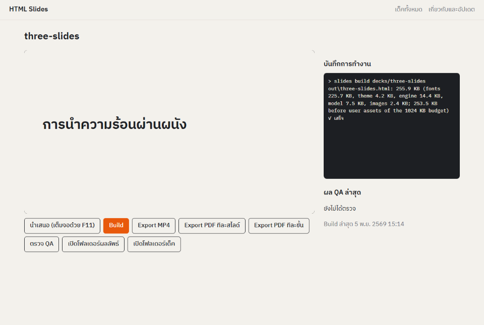

- **Write text, present animation.** Write each slide's final state, then list what to reveal, one Step per click, in a `steps` block: `build #rule`, `count-up #q from=0`.
- **18 explanation Moves.** Reveal one idea at a time, dim everything but the point, trace a path, zoom into a detail, count a number up, and more.
- **PowerPoint Presets.** Appear, fade, fly in, wipe, zoom, spin, colour changes, motion paths and more.
- **One file.** Fonts, images and the engine are embedded in the HTML. Anyone can open it with no install and no network.
- **PowerPoint import.** A `.pptx` file's text, tables, images and speaker notes become a starting deck.
- **Nine automatic QA checks.** Overflow, edge margins, overlapping text, small text, Thai words broken across lines, reduced motion, file size, offline use and repeatable rendering.
- **No telemetry.** The only network call the program makes on its own is checking GitHub for the latest release, at most once a day.

## Contents

1. [Install on Windows](#1-install-on-windows)
2. [Install on Ubuntu](#2-install-on-ubuntu)
3. [A first deck in 10 minutes](#3-a-first-deck-in-10-minutes)
4. [The deck format](#4-the-deck-format)
5. [The 18 Moves](#5-the-18-moves)
6. [PowerPoint Presets](#6-powerpoint-presets)
7. [MP4 and PDF export](#7-mp4-and-pdf-export)
8. [The QA check](#8-the-qa-check)
9. [Import from PowerPoint](#9-import-from-powerpoint)
10. [Updating](#10-updating)
11. [Every command](#11-every-command)
12. [Troubleshooting](#12-troubleshooting)
13. [Component licences](#13-component-licences)

---

## 1. Install on Windows

You need 64-bit Windows 10 (1809 or later) or Windows 11, about 1 GB free and a network connection for the first install.

The [latest Release](https://github.com/napejoon/html-slides-releases/releases/latest) has two installers. Pick one, not both.

| File | Installs for | Admin needed | Best for |
|---|---|---|---|
| `html-slides_<version>_x64-setup.exe` | you only (`%LOCALAPPDATA%\Programs\HTML Slides`) | no | your own PC (recommended) |
| `html-slides_<version>_x64.msi` | every user (`C:\Program Files\HTML Slides`) | yes | labs and IT deployment |

1. Download the `.exe` (or `.msi`) from the [latest Release](https://github.com/napejoon/html-slides-releases/releases/latest).
2. Double-click it.
3. **If Windows shows a blue "Windows protected your PC" box** (SmartScreen), the installer is not code-signed yet. Click **More info**, then **Run anyway**.
   - With **Smart App Control** on, Windows blocks unsigned installers outright, with no Run anyway button. You must turn Smart App Control off first (Settings > Privacy & security > Windows Security > App & browser control > Smart App Control). Once off, it cannot be turned back on without reinstalling Windows. If you prefer not to, wait for a signed release.
4. Accept the licence and click Install.
5. The installer then runs **Setup**. Setup downloads two components that may not be redistributed with the program, about 230 MB once per user, and checks each file's SHA-256:
   - **Chrome headless shell 156.0.8078.4** from Playwright, for rendering, capture and export;
   - **ffmpeg 9.0.2** (Gyan's essentials build), for MP4.
6. Click Finish and the **HTML Slides** window opens. Next time, start it from the Start menu entry "HTML Slides".

Installed offline? The install still succeeds, but Setup is incomplete. When you are online, open HTML Slides > **About and update** > **Retry Setup**. After Setup, the program works fully offline.

> The window opens in Microsoft Edge as an app window, and a console window sits minimised on the taskbar. The console is the program itself: if you close it, the window stops working. Closing the HTML Slides window stops the program within 30 s.

Uninstall: Settings > Apps > Installed apps > HTML Slides > Uninstall. To also remove Setup's downloads, delete `%LOCALAPPDATA%\html-slides`. Your decks in `Documents\html-slides` are kept.

## 2. Install on Ubuntu

Ubuntu 24.04 LTS (64-bit) is supported, on a real install and on WSL2. A GPG-signed apt repository lets you update with `sudo apt upgrade` or with the program's Update button.

Open a terminal and run each step.

**Step 1: download the repository key**

```bash
sudo wget -qO /usr/share/keyrings/html-slides-archive-keyring.pgp \
  https://raw.githubusercontent.com/napejoon/html-slides-releases/main/keys/html-slides-archive-keyring.pgp
```

**Step 2: check the key's fingerprint.** It must match this value exactly.

```bash
gpg --show-keys /usr/share/keyrings/html-slides-archive-keyring.pgp
```

```
37068170C47CADB135FEEDBFC0CC3DC388536F1D
```

If it does not match, **stop** and delete the file: `sudo rm /usr/share/keyrings/html-slides-archive-keyring.pgp`.

**Step 3: add the repository**

```bash
sudo tee /etc/apt/sources.list.d/html-slides.sources >/dev/null <<'EOF'
Types: deb
URIs: https://github.com/napejoon/html-slides-releases/releases/latest/download/
Suites: ./
Signed-By: /usr/share/keyrings/html-slides-archive-keyring.pgp
EOF
```

**Step 4: keep the repository from replacing Ubuntu's packages** (recommended)

```bash
sudo tee /etc/apt/preferences.d/html-slides.pref >/dev/null <<'EOF'
Package: *
Pin: origin github.com
Pin-Priority: 100
EOF
```

**Step 5: install**

```bash
sudo apt update
sudo apt install html-slides
```

apt also installs ffmpeg and the libraries Chromium needs. Setup then downloads the Chrome headless shell (about 120 MB) into `/var/opt/html-slides/ms-playwright` and checks its SHA-256. **HTML Slides** then appears in the application menu. On WSL2 it appears in the Windows Start menu. You can also run `slides ui` in a terminal.

Installed offline? Run `sudo slides setup` when you are online.

Uninstall:

```bash
sudo apt purge html-slides
sudo rm /etc/apt/sources.list.d/html-slides.sources /etc/apt/preferences.d/html-slides.pref
```

Your decks in `~/Documents/html-slides` are kept.

## 3. A first deck in 10 minutes

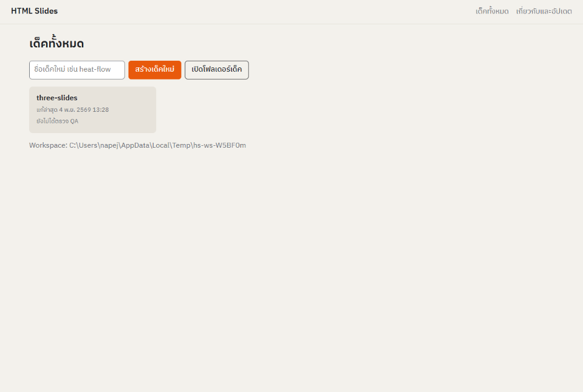

1. Open **HTML Slides**. It creates the **Workspace** `Documents/html-slides/`, which holds `decks/` (sources) and `out/` (results), and copies in the example deck `three-slides`.
2. Click `three-slides`, then **Build** to see a preview. Click **Present** to open the HTML file in your browser, then press F11 for full screen.
   - Next Step: **→**, **Space**, **Enter**, **Page Down** or click.
   - Back: **←**, **Page Up** or **Backspace**.
   - Leave full screen: **F11** or **Esc**.
3. Back on **Decks**, type a name such as `heat-flow` and click **New deck**. The program creates `decks/heat-flow/` with:
   - `deck.md`, the deck itself, which opens in your text editor;
   - `brief.md`, a short form: who is the audience, what is the topic, what is the common misconception;
   - `outline.md`, the slide-by-slide plan to write before the deck;
   - `assets/`, for images and SVG diagrams.
4. Edit `deck.md`, save, and click **Build** again. Repeat until it is right.
5. Click **QA check**. If a check fails, the log names the Slide and Step.
6. Click **Export MP4** or **Export PDF**. The files land in `out/` (**Open output folder**).

`out/<deck>.html` is the whole deck in one file: email it or carry it on a USB stick.

> To write a deck with an AI such as Claude, give it `brief.md`, `outline.md` and the [deck format](#4-the-deck-format) section of this README, and ask for `deck.md`. Paste the answer into the file, then Build and check.

## 4. The deck format

`deck.md` is plain Markdown with a few additions:

````markdown
---
title: Heat conduction through a wall
lang: en
theme: studio
---

```slide
layout: title
```

# Heat conduction through a wall {#title}

Why is a thick-walled house cooler? {#subtitle}

```steps
build #subtitle
```

```notes
Open with the question; let the room answer.
```

---

```slide
layout: two-col
transition: morph
```

## How heat flows {#heading}

- Always from the hot side to the cold side {#rule}
- The rate depends on the wall's thickness L {#depends}

q = [100]{#q} W {#qline}

::right::

{#wall}

```steps
build #rule
build #depends + circle-it #L
spotlight #wall then label #arrow-label
count-up #q from=0 dur=1.2s
```
````

Rules:

- **Front matter** (between the first `---` lines): `title`, `lang` (`th` or `en`) and `theme` (`studio` for now).
- **A line with only `---`** separates Slides.
- **The `slide` block** takes three settings:
  - `layout` is `title`, `content`, `two-col`, `figure` or `section`;
  - `transition` is `none`, `fade`, `push` or `morph`;
  - `hold=` sets the dwell time for autoplay.
- **The content is the final state.** Write everything visible when the Slide ends; `steps` says what appears when.
- **`{#id}`** names an Element that will move: put it after a heading, a paragraph, a list or an image. `[text]{#id}` names a single word inside a sentence.
- **`::right::`** starts the right column of `two-col`.
- **SVG.** `.svg` files in `assets/` are embedded inline. Give parts of the SVG an `id` and Moves can target them (`#L`, `#arrow-label`). Write subscripts as `<tspan>`.
- **The `steps` block** holds one Step (one click) per line:
  - `A + B` runs together; `A then B` runs one after the other within one click;
  - options are `name=value`: `from=0`, `dur=1.2s`, `dx=-800`;
  - make one change per Step and use at most 6 Steps per Slide.
- **The `notes` block** holds speaker notes, which never show on the Slide. Prose belongs in Notes; the Slide carries labels and short phrases.

## 5. The 18 Moves

| Move | What it does | Example |
|---|---|---|
| `build` | reveal one idea at a time; `by=paragraph` or `by=word` reveals per paragraph or per word (Thai too) | `build #rule` |
| `stagger-in` | reveal a list item by item, staggered | `stagger-in #list` |
| `write-on` | draw an SVG line or arrow along its length | `write-on #arrow` |
| `retire` | fade out what has been explained | `retire #b` |
| `spotlight` | dim everything but the point, until the next Step | `spotlight #wall` |
| `point-at` | an arrow points at an Element | `point-at #a` |
| `circle-it` | draw a ring around an Element | `circle-it #L` |
| `flash-change` | flash what just changed | `flash-change #a` |
| `trace` | a dot travels along a path, for flows | `trace #p` |
| `move-to` | move an Element | `move-to #a dx=-800 dy=100` |
| `morph` | turn one state into another on the same Slide | `morph #s1 #s2` |
| `substitute` | replace an Element in place | `substitute #old #new` |
| `zoom-in` / `zoom-out` | zoom the camera into a detail and back out | `zoom-in #detail` |
| `pan-to` | move the camera to another part of the picture | `pan-to #right` |
| `count-up` | count a number up or down | `count-up #q from=0` |
| `label` | a label with a leader line | `label #callout` |
| `replay` | replay the previous Step with one value changed | `replay dx=-1200` |

<table>
<tr><td>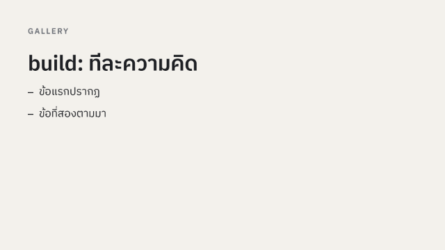<br><code>build</code></td><td>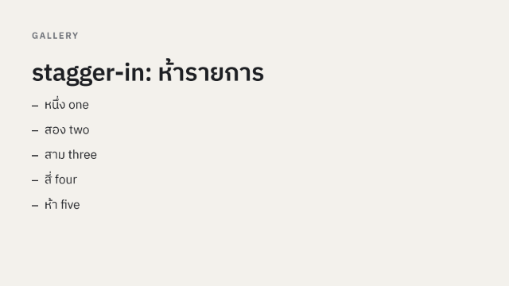<br><code>stagger-in</code></td><td>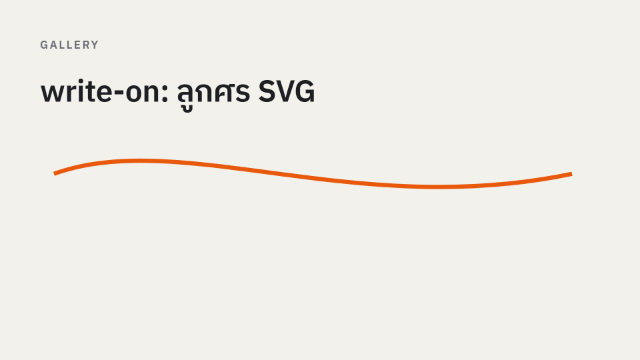<br><code>write-on</code></td></tr>
<tr><td>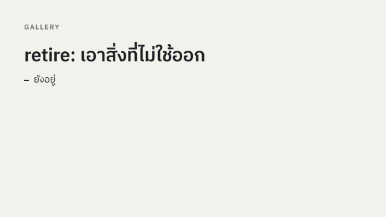<br><code>retire</code></td><td>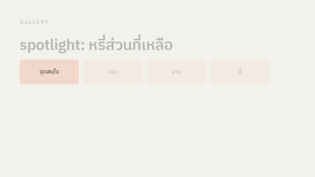<br><code>spotlight</code></td><td>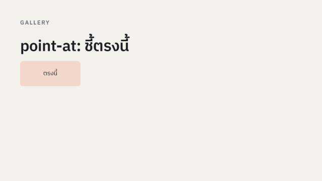<br><code>point-at</code></td></tr>
<tr><td>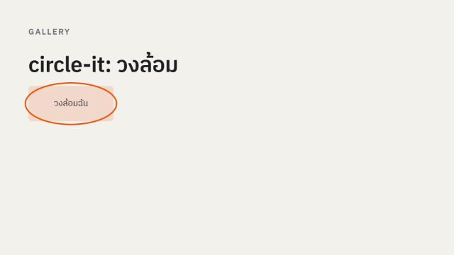<br><code>circle-it</code></td><td>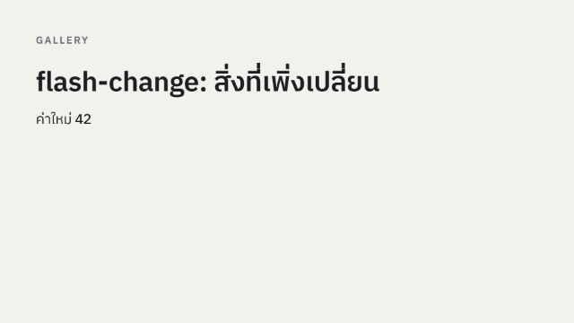<br><code>flash-change</code></td><td>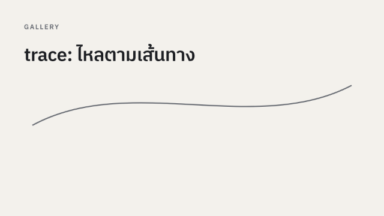<br><code>trace</code></td></tr>
<tr><td>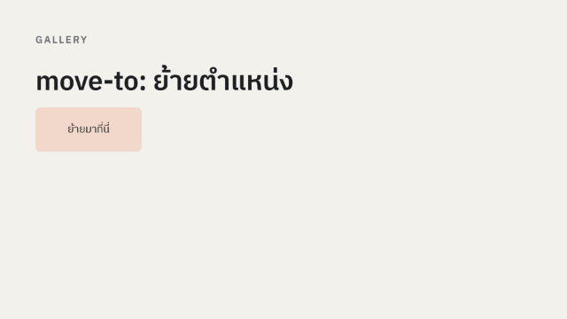<br><code>move-to</code></td><td>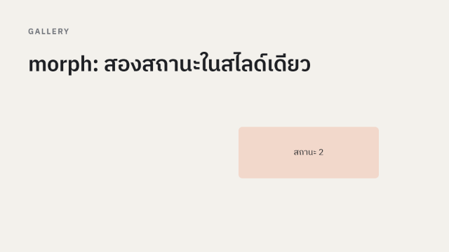<br><code>morph</code></td><td>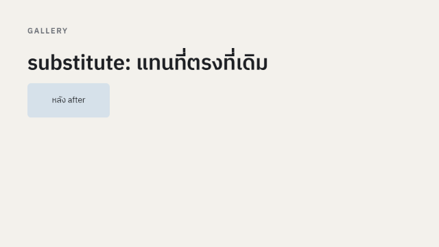<br><code>substitute</code></td></tr>
<tr><td>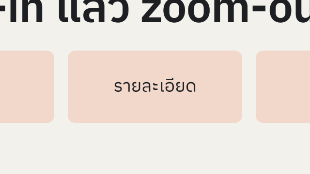<br><code>zoom-in</code> / <code>zoom-out</code></td><td>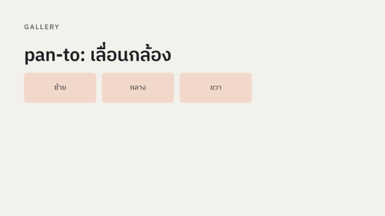<br><code>pan-to</code></td><td>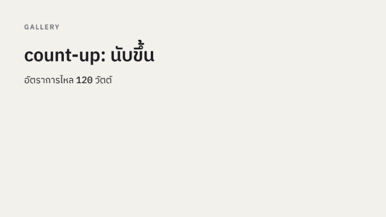<br><code>count-up</code></td></tr>
<tr><td>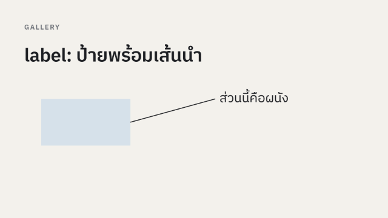<br><code>label</code></td><td>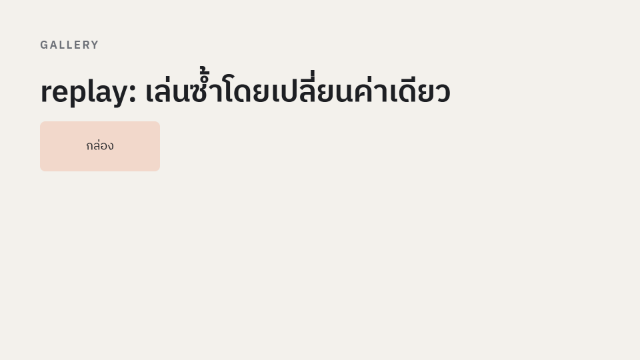<br><code>replay</code></td><td></td></tr>
</table>

## 6. PowerPoint Presets

If you know PowerPoint, write `preset <name> #id [options]` in a `steps` block.

| Group | Presets | Options |
|---|---|---|
| Entrance | `appear`, `fade`, `fly-in`, `wipe`, `zoom`, `float-in`, `split` | `fly-in from=left` (`left`, `right`, `top`, `bottom`, `top-left`, `top-right`, `bottom-left`, `bottom-right`) · `wipe from=left` · `float-in dir=up` · `split orient=vertical` |
| Exit | `disappear`, `fade-out`, `fly-out`, `wipe-out`, `zoom-out-preset`, `float-out`, `split-out` | `fly-out to=left` · `wipe-out to=left` |
| Emphasis | `pulse`, `grow-shrink`, `spin`, `fill-color`, `font-color`, `transparency` | `grow-shrink size=1.3` · `transparency amount=0.4` |
| Motion path | `lines`, `arcs`, `custom-path` | `lines dir=right dist=150` · `arcs dist=600` · `custom-path d=M0,0_C200,-200_400,200_600,0` |

Example: `preset fly-in #a from=left + preset fade #b`

Slide transitions (`transition:` in the `slide` block) are `none`, `fade`, `push` and `morph`. `morph` moves Elements whose `id` matches the previous Slide's to their new place.

## 7. MP4 and PDF export

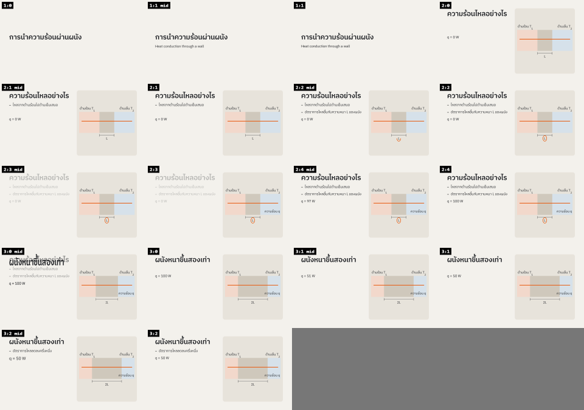

- **MP4**: a silent 1920×1080 video that plays every Step in turn. Each Step's dwell time comes from its word count; `hold=` changes it. Use it to upload, or to show where there is no browser.
- **PDF per Slide**: one page per Slide in its final state, for handouts.
- **PDF per Step**: one page per Step, for presenting from a PDF reader.
- **Sheet** (command line): every Step as a thumbnail in one image, for a quick review.

Everything goes to `Documents/html-slides/out/`.

## 8. The QA check

**QA check** (or `slides check decks/<name>`) checks every Step of every Slide and writes `out/<name>/qa.md`.

| # | Check |
|---|---|
| 1 | an Element overflows the Slide |
| 2 | text closer than 60 px to an edge |
| 3 | text overlapping text |
| 4 | text under 34 px (unreadable from the back of the room) |
| 5 | a Thai word broken across lines |
| 6 | reduced motion reaches the right end states |
| 7 | HTML under 1 MB before your own images |
| 8 | opens offline with no console error |
| 9 | the same Still twice is byte-identical |

## 9. Import from PowerPoint

```bash
slides import lecture.pptx -o decks/lecture
```

This writes `decks/lecture/deck.md`, `assets/` and `import-report.md`. The report says, Slide by Slide, what was dropped or replaced by a placeholder.

- **Imported**: Slide order, titles, text with bullet levels, links, tables, images, speaker notes, and the `fade`, `push` and `morph` transitions.
- **Animations**: they become comment lines such as `// preset fade #body` in the `steps` block; delete the `//` to use one.
- **Charts, SmartArt, video and equations**: they become placeholders to redo.
- **Positions**: they are not imported; the program picks the nearest layout instead.

## 10. Updating

- At start, the program checks for a new version at most once a day. You can also use **About and update** > **Check for updates**. A new version shows a banner with its release notes.
- **Update now** downloads the files and checks the Ed25519 signature on `SHA256SUMS` and each file's hash. Nothing installs if a check fails. If the checks pass:
  - **Windows** runs the same installer kind you have (the `.exe` silently, or the `.msi` with its admin prompt) and reopens the window;
  - **Ubuntu** asks for your password (pkexec) and upgrades through apt. `sudo apt update && sudo apt upgrade` works too.
- Nothing installs without your click, and none of your data leaves your computer.

## 11. Every command

On Ubuntu, use `slides`. On Windows, replace `slides` with `"%LOCALAPPDATA%\Programs\HTML Slides\node\node.exe" "%LOCALAPPDATA%\Programs\HTML Slides\app\tools\slides.mjs"`. Run each command in the Workspace folder.

| Command | Result |
|---|---|
| `slides ui` | the HTML Slides window |
| `slides build decks/<name>` | `out/<name>.html` |
| `slides export decks/<name> --mp4 [--fps 30]` | `out/<name>.mp4` |
| `slides export decks/<name> --pdf [--per-step]` | `out/<name>.pdf` |
| `slides capture decks/<name> --stills steps --sheet` | a Still per Step and a Sheet |
| `slides check decks/<name>` | `out/<name>/qa.md` |
| `slides import <file.pptx> -o decks/<name>` | a deck from PowerPoint |
| `slides doctor` | checks Node, ffmpeg, the browser and the fonts |
| `slides setup [--status]` | downloads or checks the browser and ffmpeg |
| `slides update --check` | checks for a new version |

## 12. Troubleshooting

| Symptom | Fix |
|---|---|
| "Windows protected your PC" | More info > Run anyway ([section 1](#1-install-on-windows)) |
| Smart App Control blocks it, with no Run anyway | the installer is unsigned; turn Smart App Control off or wait for a signed release |
| About and update shows Browser or ffmpeg as ✗ | go online and click **Retry Setup** (Ubuntu: `sudo slides setup`) |
| Setup fails behind a company proxy | set `HTTPS_PROXY` and run `slides setup` again |
| On Ubuntu or WSL the Update button says pkexec is unavailable | run `sudo apt update && sudo apt install --only-upgrade html-slides` |
| No window appears | the window may already be open; look at the taskbar. Without Edge or Chrome the program uses your default browser |
| MP4 export fails | run `slides doctor`: the ffmpeg line must be OK, with libx264 |
| QA check 4 or 5 fails | shorten the on-slide text, move detail into Notes, or split the Slide |
| Move the Workspace | edit `"workspace"` in `%APPDATA%\html-slides\settings.json` (Ubuntu: `~/.config/html-slides/settings.json`) |

Still stuck? Open an [issue](https://github.com/napejoon/html-slides-releases/issues) with the output of `slides doctor` and `slides setup --status`.

## 13. Component licences

- **HTML Slides** is freeware: free for any use, commercial use included. You may share the unmodified installers but not distribute modified ones ([LICENSE](LICENSE)).
- **Your decks are yours.** The engine and theme embedded in every deck's HTML are MIT-licensed, so decks can be shared and changed freely.
- **Shipped with the program**: Node.js (MIT), Playwright (Apache-2.0), esbuild (MIT), markdown-it and plugins (MIT), fast-xml-parser (MIT), pixelmatch (ISC), pngjs (MIT), and the IBM Plex Sans Thai and IBM Plex Mono fonts (SIL Open Font License 1.1). The full texts are in `THIRD-PARTY-NOTICES.txt` in the install folder.
- **Not shipped with the program**; Setup downloads these from their publishers on your machine:
  - Chrome headless shell 156.0.8078.4 from the Playwright CDN (BSD-3-Clause and others);
  - on Windows, the ffmpeg 9.0.2 essentials build by Gyan Doshi, a separate program under the GNU GPL v3, with source at <https://github.com/GyanD/codexffmpeg/releases/tag/9.0.2> and <https://ffmpeg.org/download.html>;
  - on Ubuntu, ffmpeg from Ubuntu's apt.
- Every release carries `SHA256SUMS` and `SHA256SUMS.sig` to check the downloads; the public key is [keys/update-signing-public.pem](keys/update-signing-public.pem).
