# HTML Slides

[English](README.en.md)

HTML Slides สร้างสไลด์นำเสนอที่ **อธิบายด้วยแอนิเมชัน** จากไฟล์ข้อความ (Markdown) ออกมาเป็น **ไฟล์ HTML ไฟล์เดียว** ที่เปิดได้ในเบราว์เซอร์ทุกตัวแบบออฟไลน์ ส่งออกเป็น **MP4** และ **PDF** ได้ และตรวจคุณภาพอัตโนมัติได้ ผลลัพธ์ออกมาเหมือนกันทุกพิกเซลทั้งบน Windows 11 และ Ubuntu 24.04

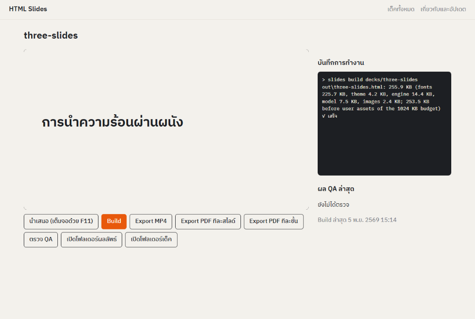

- **เขียนเป็นข้อความ แสดงเป็นแอนิเมชัน**: เนื้อหาเขียนเป็นสถานะสุดท้ายของสไลด์ แล้วบอกลำดับการเผยทีละขั้นในบล็อก `steps` เช่น `build #rule` หรือ `count-up #q from=0`
- **ท่าอธิบาย 18 แบบ (Moves)**: เผยทีละความคิด, หรี่ส่วนอื่นให้เห็นจุดสำคัญ, ลากเส้นตามเส้นทาง, ซูมเข้าไปดูรายละเอียด, นับตัวเลขขึ้น ฯลฯ
- **Preset ของ PowerPoint**: ปรากฏ, จางเข้า, บินเข้า, เช็ด, ซูม, หมุน, เปลี่ยนสี, เส้นทางการเคลื่อนที่ และอื่น ๆ
- **ไฟล์เดียวจบ**: ฟอนต์ ภาพ และ engine ฝังอยู่ในไฟล์ HTML ส่งให้ใครก็เปิดได้ ไม่ต้องติดตั้งอะไร ไม่ต้องใช้อินเทอร์เน็ต
- **นำเข้าจาก PowerPoint**: ดึงข้อความ ตาราง ภาพ และโน้ตของผู้บรรยายจากไฟล์ `.pptx` มาเป็นเด็คเริ่มต้น
- **ตรวจ QA อัตโนมัติ 9 ข้อ**: ล้นขอบ, ชิดขอบ, ข้อความซ้อน, ตัวเล็กเกิน, คำไทยถูกตัดกลางคำ, โหมดลดการเคลื่อนไหว, ขนาดไฟล์, ใช้งานออฟไลน์ และภาพซ้ำได้แน่นอน
- **ไม่มี telemetry**: โปรแกรมติดต่ออินเทอร์เน็ตเองแค่อย่างเดียว คือตรวจ release ล่าสุดบน GitHub วันละไม่เกินหนึ่งครั้ง

## สารบัญ

1. [ติดตั้งบน Windows](#1-ติดตั้งบน-windows)
2. [ติดตั้งบน Ubuntu](#2-ติดตั้งบน-ubuntu)
3. [เด็คแรกใน 10 นาที](#3-เด็คแรกใน-10-นาที)
4. [รูปแบบไฟล์เด็ค](#4-รูปแบบไฟล์เด็ค)
5. [ท่าอธิบาย 18 แบบ (Moves)](#5-ท่าอธิบาย-18-แบบ-moves)
6. [Preset ของ PowerPoint](#6-preset-ของ-powerpoint)
7. [ส่งออก MP4 และ PDF](#7-ส่งออก-mp4-และ-pdf)
8. [ตรวจ QA](#8-ตรวจ-qa)
9. [นำเข้าจาก PowerPoint](#9-นำเข้าจาก-powerpoint)
10. [การอัปเดต](#10-การอัปเดต)
11. [คำสั่งทั้งหมด (command line)](#11-คำสั่งทั้งหมด-command-line)
12. [แก้ปัญหา](#12-แก้ปัญหา)
13. [สัญญาอนุญาตของส่วนประกอบ](#13-สัญญาอนุญาตของส่วนประกอบ)

---

## 1. ติดตั้งบน Windows

ต้องใช้ Windows 10 (1809 ขึ้นไป) หรือ Windows 11 แบบ 64 บิต พื้นที่ว่างประมาณ 1 GB และอินเทอร์เน็ตตอนติดตั้งครั้งแรก

มีตัวติดตั้งให้เลือกสองแบบใน [Releases ล่าสุด](https://github.com/napejoon/html-slides-releases/releases/latest) ให้เลือกแบบเดียวเท่านั้น

| ไฟล์ | ติดตั้งให้ | ต้องเป็น admin | เหมาะกับ |
|---|---|---|---|
| `html-slides_<เวอร์ชัน>_x64-setup.exe` | ผู้ใช้คนเดียว (`%LOCALAPPDATA%\Programs\HTML Slides`) | ไม่ต้อง | ใช้เองบนเครื่องตัวเอง (แนะนำ) |
| `html-slides_<เวอร์ชัน>_x64.msi` | ทุกคนในเครื่อง (`C:\Program Files\HTML Slides`) | ต้อง | ห้องแล็บหรือฝ่าย IT ที่ติดตั้งหลายเครื่อง |

ขั้นตอน:

1. ดาวน์โหลด `.exe` (หรือ `.msi`) จาก [Releases ล่าสุด](https://github.com/napejoon/html-slides-releases/releases/latest)
2. ดับเบิลคลิกไฟล์ที่ดาวน์โหลดมา
3. **ถ้า Windows ขึ้นกล่องสีน้ำเงิน "Windows protected your PC"** (SmartScreen) แปลว่าตัวติดตั้งรุ่นนี้ยังไม่มีใบรับรองการลงนามโค้ด ให้กด **More info** แล้วกด **Run anyway**
   - ถ้าเปิด **Smart App Control** ไว้ Windows จะบล็อกตัวติดตั้งที่ไม่ได้ลงนามทันที และไม่มีปุ่ม Run anyway ต้องปิด Smart App Control ก่อนที่ Settings > Privacy & security > Windows Security > App & browser control > Smart App Control เมื่อปิดแล้วจะเปิดกลับไม่ได้ถ้าไม่ติดตั้ง Windows ใหม่ ถ้าไม่อยากปิด ให้รอรุ่นที่ลงนามแล้ว
4. อ่านและยอมรับสัญญาอนุญาต แล้วกด Install
5. ตัวติดตั้งจะทำ **Setup** ต่อทันที คือดาวน์โหลดสองอย่างที่ห้ามแจกจ่ายไปพร้อมโปรแกรม (รวมประมาณ 230 MB ครั้งเดียวต่อผู้ใช้หนึ่งคน) และตรวจ SHA-256 ทุกไฟล์:
   - **Chrome headless shell 156.0.8078.4** จาก Playwright ใช้วาดภาพ จับภาพ และส่งออก
   - **ffmpeg 9.0.2** (essentials build ของ Gyan) ใช้สร้าง MP4
6. กด Finish หน้าต่าง **HTML Slides** จะเปิดขึ้นมา ครั้งต่อไปเปิดได้จาก Start menu ชื่อ "HTML Slides"

ถ้าตอนติดตั้งไม่ได้ต่ออินเทอร์เน็ต การติดตั้งจะยังสำเร็จ แต่ Setup จะยังไม่ครบ เมื่อออนไลน์แล้วให้เปิดหน้าต่าง HTML Slides > **เกี่ยวกับและอัปเดต** > **Retry Setup** หลัง Setup ครบแล้วโปรแกรมใช้งานแบบออฟไลน์ได้ทั้งหมด

> หน้าต่าง HTML Slides เปิดใน Microsoft Edge แบบหน้าต่างแอป และมีหน้าต่างคอนโซลย่ออยู่ที่ taskbar อีกหนึ่งหน้าต่าง คอนโซลนั้นคือตัวโปรแกรมที่ทำงานอยู่ ถ้าปิดคอนโซล หน้าต่างโปรแกรมจะใช้ต่อไม่ได้ เมื่อปิดหน้าต่าง HTML Slides ตัวโปรแกรมจะหยุดเองภายใน 30 วินาที

ถอนการติดตั้ง: Settings > Apps > Installed apps > HTML Slides > Uninstall ถ้าจะลบไฟล์ที่ Setup ดาวน์โหลดมาด้วย ให้ลบโฟลเดอร์ `%LOCALAPPDATA%\html-slides` เด็คของคุณใน `Documents\html-slides` จะไม่ถูกลบ

## 2. ติดตั้งบน Ubuntu

รองรับ Ubuntu 24.04 LTS แบบ 64 บิต ทั้งที่ติดตั้งบนเครื่องจริงและบน WSL2 การติดตั้งใช้ apt repository ที่ลงนามด้วย GPG จึงอัปเดตได้ทั้งผ่าน `sudo apt upgrade` และปุ่มอัปเดตในโปรแกรม

เปิด Terminal แล้วรันทีละขั้น

**ขั้นที่ 1: ดาวน์โหลดกุญแจของ repository**

```bash
sudo wget -qO /usr/share/keyrings/html-slides-archive-keyring.pgp \
  https://raw.githubusercontent.com/napejoon/html-slides-releases/main/keys/html-slides-archive-keyring.pgp
```

**ขั้นที่ 2: ตรวจลายนิ้วมือของกุญแจ** ต้องตรงกับค่าด้านล่างทุกตัวอักษร

```bash
gpg --show-keys /usr/share/keyrings/html-slides-archive-keyring.pgp
```

```
37068170C47CADB135FEEDBFC0CC3DC388536F1D
```

ถ้าไม่ตรง **อย่าทำต่อ** และลบไฟล์ทิ้งด้วย `sudo rm /usr/share/keyrings/html-slides-archive-keyring.pgp`

**ขั้นที่ 3: เพิ่ม repository**

```bash
sudo tee /etc/apt/sources.list.d/html-slides.sources >/dev/null <<'EOF'
Types: deb
URIs: https://github.com/napejoon/html-slides-releases/releases/latest/download/
Suites: ./
Signed-By: /usr/share/keyrings/html-slides-archive-keyring.pgp
EOF
```

**ขั้นที่ 4: จำกัดสิทธิ์ของ repository** ไม่ให้แทนที่แพ็กเกจของ Ubuntu (แนะนำ)

```bash
sudo tee /etc/apt/preferences.d/html-slides.pref >/dev/null <<'EOF'
Package: *
Pin: origin github.com
Pin-Priority: 100
EOF
```

**ขั้นที่ 5: ติดตั้ง**

```bash
sudo apt update
sudo apt install html-slides
```

apt จะติดตั้ง ffmpeg และ library ที่ Chromium ต้องใช้ให้ด้วย จากนั้น Setup จะดาวน์โหลด Chrome headless shell (ประมาณ 120 MB) ไปไว้ที่ `/var/opt/html-slides/ms-playwright` และตรวจ SHA-256 เมื่อเสร็จจะมี **HTML Slides** อยู่ในเมนูแอป (บน WSL2 จะไปอยู่ใน Start menu ของ Windows) หรือพิมพ์ `slides ui` ใน Terminal ก็ได้

ถ้าตอนติดตั้งไม่ได้ต่ออินเทอร์เน็ต เมื่อออนไลน์แล้วให้รัน `sudo slides setup`

ถอนการติดตั้ง:

```bash
sudo apt purge html-slides
sudo rm /etc/apt/sources.list.d/html-slides.sources /etc/apt/preferences.d/html-slides.pref
```

เด็คของคุณใน `~/Documents/html-slides` จะไม่ถูกลบ

## 3. เด็คแรกใน 10 นาที

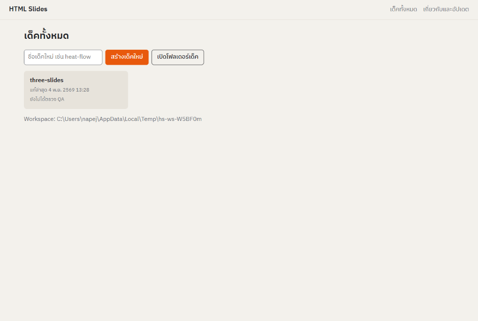

1. เปิด **HTML Slides** โปรแกรมจะสร้าง **Workspace** ไว้ที่ `Documents/html-slides/` ซึ่งมี `decks/` สำหรับต้นฉบับ และ `out/` สำหรับผลลัพธ์ พร้อมใส่เด็คตัวอย่าง `three-slides` ไว้ให้
2. คลิก `three-slides` แล้วกด **Build** จะเห็นภาพตัวอย่างของสไลด์แรก กด **นำเสนอ** เพื่อเปิดไฟล์ HTML ในเบราว์เซอร์ แล้วกด F11 ให้เต็มจอ
   - ขั้นถัดไป: **→**, **Space**, **Enter**, **Page Down** หรือคลิก
   - ย้อนกลับ: **←**, **Page Up** หรือ **Backspace**
   - ออกจากเต็มจอ: **F11** หรือ **Esc**
3. กลับไปที่หน้า **เด็คทั้งหมด** พิมพ์ชื่อเด็ค เช่น `heat-flow` แล้วกด **สร้างเด็คใหม่** โปรแกรมจะสร้างโฟลเดอร์ `decks/heat-flow/` ซึ่งมี:
   - `deck.md` คือตัวเด็ค โปรแกรมจะเปิดไฟล์นี้ใน text editor ให้
   - `brief.md` คือแบบฟอร์มสั้น ๆ ว่าจะสอนใคร เรื่องอะไร และความเข้าใจผิดที่พบบ่อยคืออะไร
   - `outline.md` คือโครงเรื่องทีละสไลด์ที่เขียนก่อนลงมือทำเด็ค
   - `assets/` คือที่ใส่ภาพและแผนภาพ SVG
4. แก้ `deck.md` แล้วบันทึก จากนั้นกลับมาที่โปรแกรมแล้วกด **Build** ทำซ้ำจนพอใจ
5. กด **ตรวจ QA** ถ้ามีข้อที่ไม่ผ่าน บันทึกการทำงานจะบอกว่าเป็นสไลด์และขั้นไหน
6. กด **Export MP4** หรือ **Export PDF** ไฟล์จะไปอยู่ใน `out/` (กดปุ่ม **เปิดโฟลเดอร์ผลลัพธ์** เพื่อดู)

ไฟล์ `out/<ชื่อเด็ค>.html` คือสไลด์ทั้งชุดในไฟล์เดียว ส่งทางอีเมลหรือใส่แฟลชไดรฟ์ไปเปิดเครื่องไหนก็ได้

> ถ้าจะให้ AI เช่น Claude ช่วยเขียนเด็ค ให้ส่ง `brief.md`, `outline.md` และหัวข้อ [รูปแบบไฟล์เด็ค](#4-รูปแบบไฟล์เด็ค) ของ README นี้ไปให้ แล้วขอให้เขียน `deck.md` จากนั้นวางผลลัพธ์ลงไฟล์ แล้ว Build และตรวจ QA

## 4. รูปแบบไฟล์เด็ค

`deck.md` เป็น Markdown ธรรมดาที่มีส่วนเสริมไม่กี่อย่าง ตัวอย่างเต็ม:

````markdown
---
title: การนำความร้อนผ่านผนัง
lang: th
theme: studio
---

```slide
layout: title
```

# การนำความร้อนผ่านผนัง {#title}

Heat conduction through a wall {#subtitle}

```steps
build #subtitle
```

```notes
เปิดด้วยคำถาม: ทำไมบ้านผนังหนาถึงเย็นกว่า
```

---

```slide
layout: two-col
transition: morph
```

## ความร้อนไหลอย่างไร {#heading}

- ไหลจากด้านร้อนไปด้านเย็นเสมอ {#rule}
- อัตราการไหลขึ้นกับความหนา L ของผนัง {#depends}

q = [100]{#q} W {#qline}

::right::

{#wall}

```steps
build #rule
build #depends + circle-it #L
spotlight #wall then label #arrow-label
count-up #q from=0 dur=1.2s
```
````

หลักการเขียน:

- **ส่วนหัว** (ระหว่าง `---` บนสุด): `title`, `lang` (`th` หรือ `en`) และ `theme` (ตอนนี้มี `studio`)
- **`---` บรรทัดเดียว** ใช้คั่นระหว่างสไลด์
- **บล็อก `slide`** มี 3 ค่า:
  - `layout` เป็น `title`, `content`, `two-col`, `figure` หรือ `section`
  - `transition` เป็น `none`, `fade`, `push` หรือ `morph`
  - `hold=` กำหนดเวลาค้างตอนเล่นอัตโนมัติ
- **เนื้อหาคือสถานะสุดท้าย**: เขียนทุกอย่างที่ต้องเห็นเมื่อสไลด์จบ แล้วใช้ `steps` บอกว่าจะเผยอะไรเมื่อไร
- **`{#id}`** ตั้งชื่อชิ้นส่วนที่จะขยับ ใส่ไว้ท้ายหัวข้อ ย่อหน้า รายการ หรือภาพ ส่วน `[ข้อความ]{#id}` ใช้ตั้งชื่อคำเดียวในประโยค
- **`::right::`** แบ่งคอลัมน์ขวาของ `two-col`
- **SVG**: ภาพ `.svg` ใน `assets/` จะถูกฝังลงไปตรง ๆ ถ้าใส่ `id` ให้ชิ้นส่วนใน SVG ก็สั่งขยับชิ้นส่วนนั้นได้ (เช่น `#L`, `#arrow-label`) ตัวห้อยเขียนด้วย `<tspan>`
- **บล็อก `steps`**: หนึ่งบรรทัดคือหนึ่งขั้น (หนึ่งคลิก)
  - `A + B` ทำพร้อมกัน · `A then B` ทำต่อกันภายในคลิกเดียว
  - ตัวเลือกเขียนเป็น `ชื่อ=ค่า` เช่น `from=0`, `dur=1.2s`, `dx=-800`
  - ขั้นละความเปลี่ยนแปลงเดียว และไม่เกิน 6 ขั้นต่อสไลด์
- **บล็อก `notes`**: โน้ตของผู้บรรยาย ไม่แสดงบนสไลด์ ข้อความยาวให้อยู่ในโน้ต บนสไลด์มีแค่ป้ายและวลีสั้น ๆ

## 5. ท่าอธิบาย 18 แบบ (Moves)

| Move | ทำอะไร | ตัวอย่าง |
|---|---|---|
| `build` | เผยทีละความคิด ใส่ `by=paragraph` หรือ `by=word` เพื่อเผยทีละย่อหน้าหรือทีละคำ (ใช้กับภาษาไทยได้) | `build #rule` |
| `stagger-in` | เผยรายการทีละข้อแบบเหลื่อมเวลา | `stagger-in #list` |
| `write-on` | วาดเส้นหรือลูกศร SVG ให้เห็นทีละช่วง | `write-on #arrow` |
| `retire` | ทำให้สิ่งที่อธิบายจบแล้วจางลง | `retire #b` |
| `spotlight` | หรี่ทุกอย่างยกเว้นจุดสนใจ จนถึงขั้นถัดไป | `spotlight #wall` |
| `point-at` | ลูกศรชี้ไปที่ชิ้นส่วน | `point-at #a` |
| `circle-it` | วาดวงล้อมรอบชิ้นส่วน | `circle-it #L` |
| `flash-change` | กะพริบสิ่งที่เพิ่งเปลี่ยน | `flash-change #a` |
| `trace` | จุดเคลื่อนไปตามเส้นทาง เช่น แสดงการไหล | `trace #p` |
| `move-to` | ย้ายตำแหน่ง | `move-to #a dx=-800 dy=100` |
| `morph` | เปลี่ยนจากสถานะหนึ่งไปอีกสถานะภายในสไลด์เดียว | `morph #s1 #s2` |
| `substitute` | แทนที่ชิ้นส่วนตรงที่เดิม | `substitute #old #new` |
| `zoom-in` / `zoom-out` | ซูมกล้องเข้าไปดูรายละเอียดแล้วถอยออกมา | `zoom-in #detail` |
| `pan-to` | เลื่อนกล้องไปอีกส่วนของภาพ | `pan-to #right` |
| `count-up` | นับตัวเลขขึ้นหรือลง | `count-up #q from=0` |
| `label` | ป้ายพร้อมเส้นนำชี้ไปที่ชิ้นส่วน | `label #callout` |
| `replay` | เล่นขั้นก่อนหน้าซ้ำโดยเปลี่ยนค่าเดียว | `replay dx=-1200` |

<table>
<tr><td>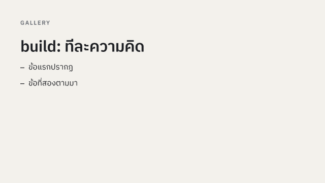<br><code>build</code></td><td>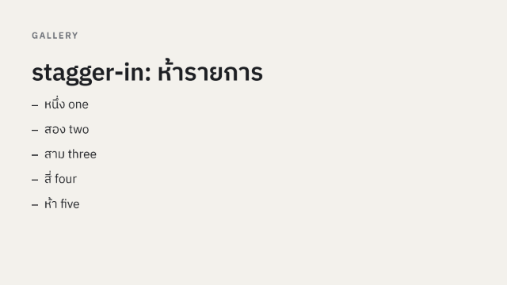<br><code>stagger-in</code></td><td>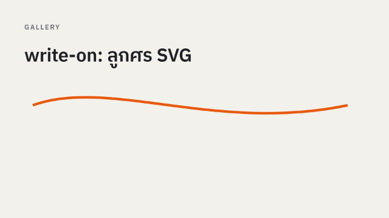<br><code>write-on</code></td></tr>
<tr><td>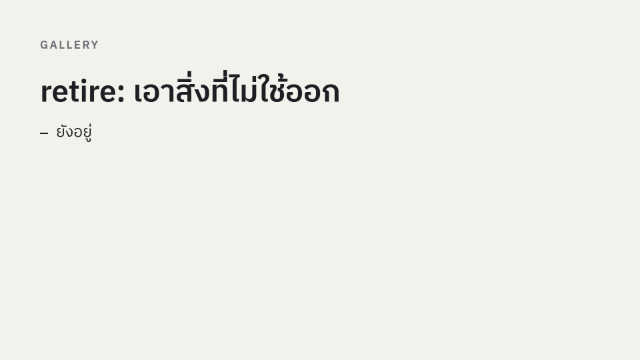<br><code>retire</code></td><td>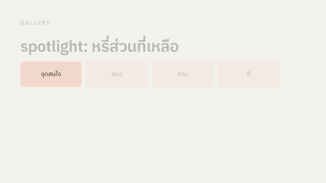<br><code>spotlight</code></td><td>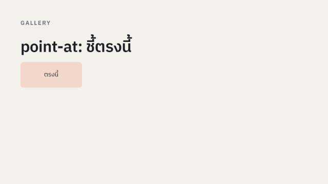<br><code>point-at</code></td></tr>
<tr><td>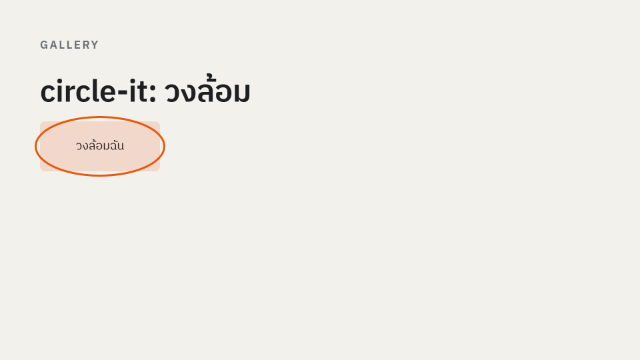<br><code>circle-it</code></td><td>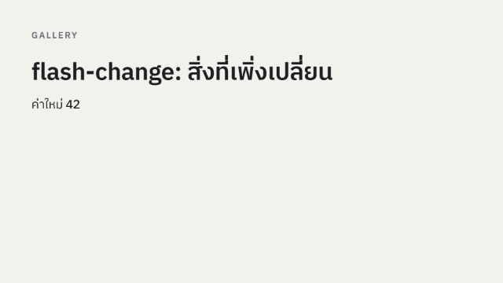<br><code>flash-change</code></td><td>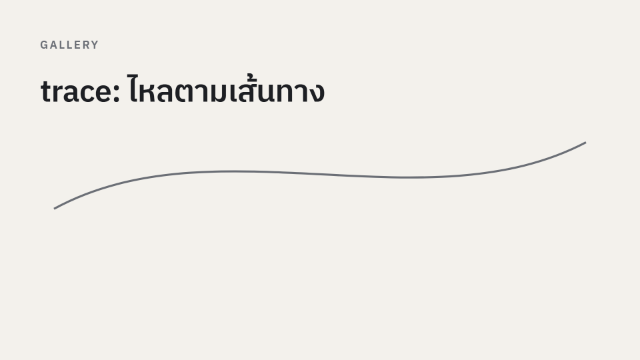<br><code>trace</code></td></tr>
<tr><td>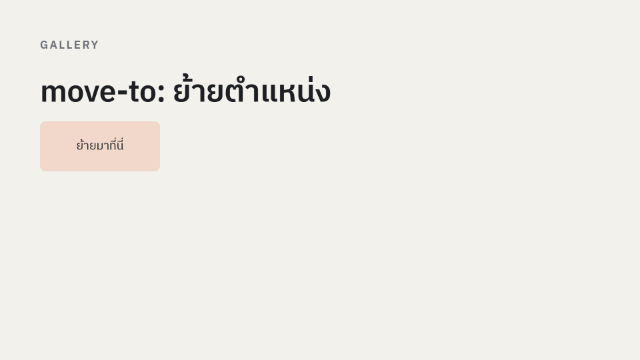<br><code>move-to</code></td><td>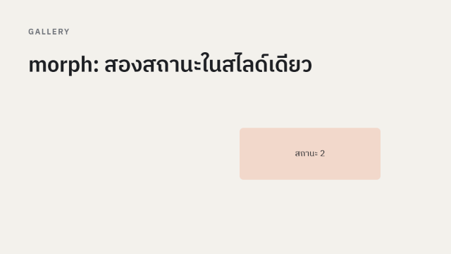<br><code>morph</code></td><td>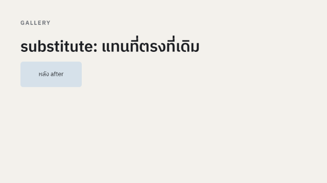<br><code>substitute</code></td></tr>
<tr><td>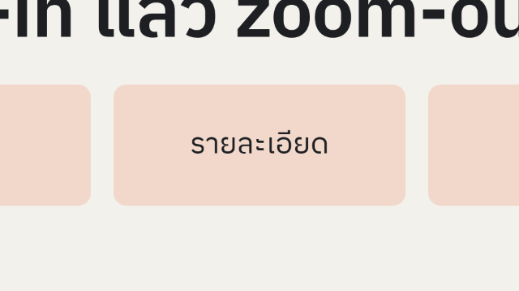<br><code>zoom-in</code> / <code>zoom-out</code></td><td>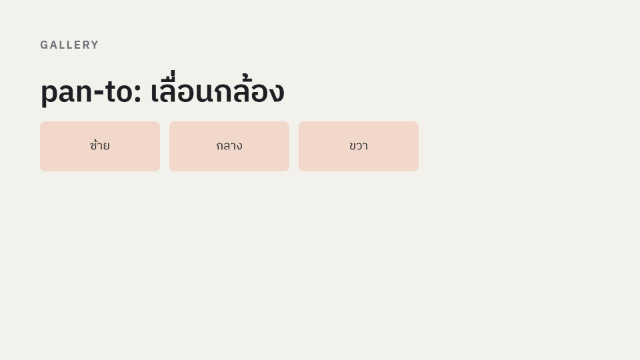<br><code>pan-to</code></td><td>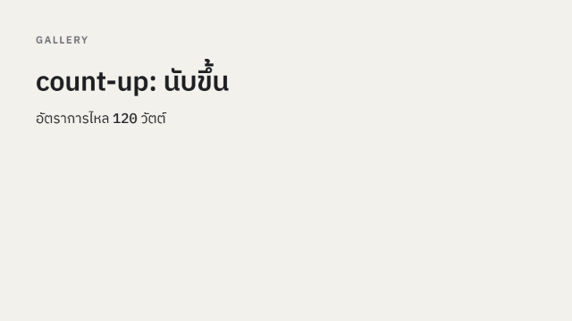<br><code>count-up</code></td></tr>
<tr><td>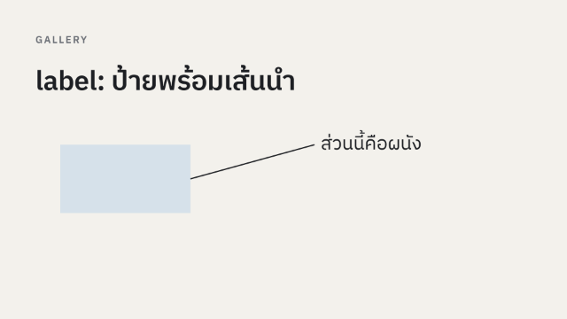<br><code>label</code></td><td>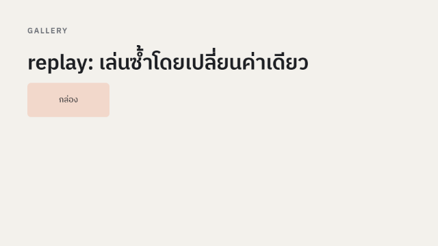<br><code>replay</code></td><td></td></tr>
</table>

## 6. Preset ของ PowerPoint

สำหรับคนที่คุ้นกับ PowerPoint ให้เขียน `preset <ชื่อ> #id [ตัวเลือก]` ในบล็อก `steps`

| กลุ่ม | Preset | ตัวเลือก |
|---|---|---|
| เข้า (Entrance) | `appear`, `fade`, `fly-in`, `wipe`, `zoom`, `float-in`, `split` | `fly-in from=left` (ทิศ: `left`, `right`, `top`, `bottom`, `top-left`, `top-right`, `bottom-left`, `bottom-right`) · `wipe from=left` · `float-in dir=up` · `split orient=vertical` |
| ออก (Exit) | `disappear`, `fade-out`, `fly-out`, `wipe-out`, `zoom-out-preset`, `float-out`, `split-out` | `fly-out to=left` · `wipe-out to=left` |
| เน้น (Emphasis) | `pulse`, `grow-shrink`, `spin`, `fill-color`, `font-color`, `transparency` | `grow-shrink size=1.3` · `transparency amount=0.4` |
| เส้นทาง (Motion path) | `lines`, `arcs`, `custom-path` | `lines dir=right dist=150` · `arcs dist=600` · `custom-path d=M0,0_C200,-200_400,200_600,0` |

ตัวอย่าง: `preset fly-in #a from=left + preset fade #b`

การเปลี่ยนสไลด์ (`transition:` ในบล็อก `slide`) มี `none`, `fade`, `push` และ `morph` โดย `morph` จะเลื่อนชิ้นส่วนที่มี `id` ตรงกันจากสไลด์ก่อนหน้ามายังตำแหน่งใหม่

## 7. ส่งออก MP4 และ PDF

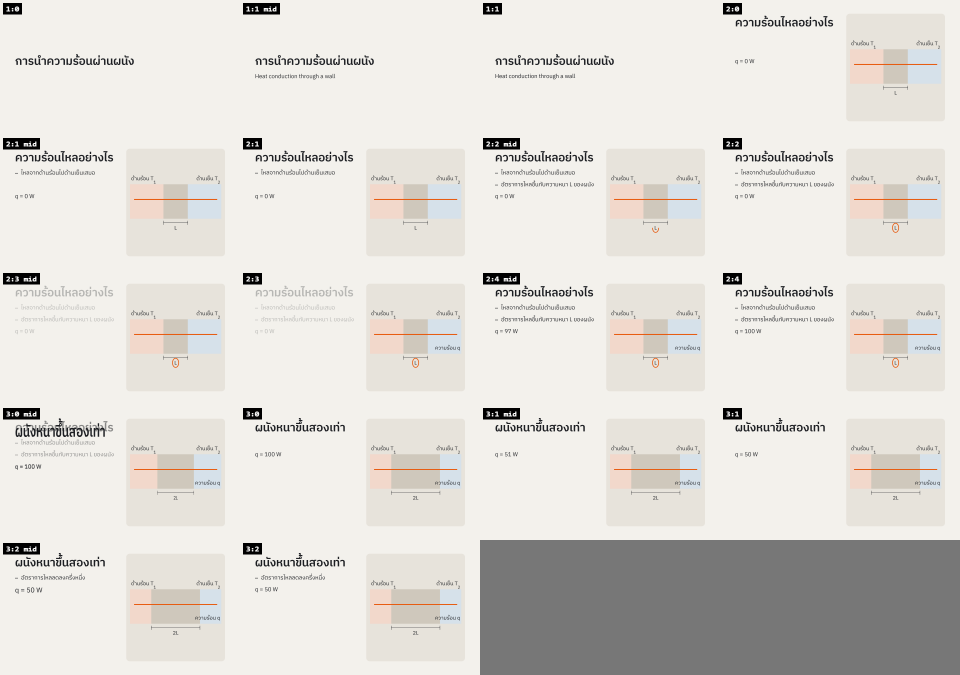

- **MP4**: วิดีโอไม่มีเสียงขนาด 1920×1080 เล่นทุกขั้นต่อกันอัตโนมัติ เวลาค้างของแต่ละขั้นคำนวณจากจำนวนคำ (ปรับได้ด้วย `hold=`) ใช้อัปโหลดหรือฉายในที่ที่ไม่มีเบราว์เซอร์
- **PDF ทีละสไลด์**: หนึ่งหน้าต่อสไลด์ แสดงสถานะสุดท้าย ใช้เป็นเอกสารแจก
- **PDF ทีละขั้น**: หนึ่งหน้าต่อขั้น ใช้ฉายด้วยโปรแกรมอ่าน PDF
- **Sheet** (สร้างจาก command line): ภาพย่อของทุกขั้นรวมในภาพเดียว ใช้ตรวจงานอย่างรวดเร็ว

ไฟล์ทั้งหมดอยู่ใน `Documents/html-slides/out/`

## 8. ตรวจ QA

ปุ่ม **ตรวจ QA** (หรือคำสั่ง `slides check decks/<ชื่อ>`) ตรวจทุกขั้นของทุกสไลด์ แล้วเขียนรายงานไว้ที่ `out/<ชื่อ>/qa.md`

| # | ตรวจอะไร |
|---|---|
| 1 | ชิ้นส่วนล้นออกนอกสไลด์ |
| 2 | ข้อความอยู่ห่างขอบไม่ถึง 60 px |
| 3 | ข้อความซ้อนทับกัน |
| 4 | ตัวอักษรเล็กกว่า 34 px (คนหลังห้องอ่านไม่ออก) |
| 5 | คำไทยถูกตัดขึ้นบรรทัดใหม่กลางคำ |
| 6 | โหมดลดการเคลื่อนไหว (reduced motion) ได้สถานะสุดท้ายถูกต้อง |
| 7 | ไฟล์ HTML ไม่เกิน 1 MB ก่อนรวมภาพของผู้ใช้ |
| 8 | เปิดแบบออฟไลน์ได้และไม่มี error |
| 9 | จับภาพซ้ำสองครั้งได้ภาพเหมือนกันทุกไบต์ |

## 9. นำเข้าจาก PowerPoint

```bash
slides import lecture.pptx -o decks/lecture
```

คำสั่งนี้สร้าง `decks/lecture/deck.md`, `assets/` และ `import-report.md` รายงานจะบอกทีละสไลด์ว่าอะไรถูกตัดออกหรือถูกแทนด้วยกล่องว่าง

- **นำเข้าได้**: ลำดับสไลด์, หัวข้อ, ข้อความพร้อมระดับ bullet, ลิงก์, ตาราง, ภาพ, โน้ตผู้บรรยาย และ transition แบบ `fade`, `push`, `morph`
- **แอนิเมชัน**: กลายเป็นบรรทัดคอมเมนต์ `// preset fade #body` ในบล็อก `steps` ถ้าจะใช้ให้ลบ `//` ออก
- **กราฟ, SmartArt, วิดีโอ และสมการ**: กลายเป็นกล่องว่างที่ต้องทำใหม่
- **ตำแหน่งชิ้นส่วน**: ไม่ถูกนำมา โปรแกรมเลือก layout ที่ใกล้ที่สุดให้แทน

## 10. การอัปเดต

- เมื่อเปิดโปรแกรม จะมีการตรวจหาเวอร์ชันใหม่ไม่เกินวันละครั้ง หรือกด **เกี่ยวกับและอัปเดต** > **ตรวจหาอัปเดต** เองก็ได้ ถ้ามีเวอร์ชันใหม่ จะมีแถบแจ้งพร้อมบันทึกการเปลี่ยนแปลง
- เมื่อกด **อัปเดตตอนนี้** โปรแกรมจะดาวน์โหลดไฟล์ ตรวจลายเซ็น Ed25519 ของ `SHA256SUMS` และตรวจ hash ของไฟล์ ถ้าข้อใดไม่ผ่านจะไม่ติดตั้ง ถ้าผ่าน:
  - **Windows**: ติดตั้งด้วยตัวติดตั้งแบบเดียวกับที่ใช้อยู่ (`.exe` แบบเงียบ หรือ `.msi` ที่ถามสิทธิ์ admin) แล้วเปิดหน้าต่างใหม่ให้เอง
  - **Ubuntu**: ถามรหัสผ่าน (pkexec) แล้วอัปเกรดผ่าน apt หรือจะใช้ `sudo apt update && sudo apt upgrade` ตามปกติก็ได้
- โปรแกรมไม่ติดตั้งอะไรเองถ้าคุณไม่กด และไม่ส่งข้อมูลใด ๆ ของคุณออกไป

## 11. คำสั่งทั้งหมด (command line)

บน Ubuntu ใช้คำสั่ง `slides` ได้เลย บน Windows ให้ใช้ `"%LOCALAPPDATA%\Programs\HTML Slides\node\node.exe" "%LOCALAPPDATA%\Programs\HTML Slides\app\tools\slides.mjs"` แทนคำว่า `slides` ทุกคำสั่งให้รันในโฟลเดอร์ Workspace

| คำสั่ง | ผลลัพธ์ |
|---|---|
| `slides ui` | เปิดหน้าต่าง HTML Slides |
| `slides build decks/<ชื่อ>` | `out/<ชื่อ>.html` |
| `slides export decks/<ชื่อ> --mp4 [--fps 30]` | `out/<ชื่อ>.mp4` |
| `slides export decks/<ชื่อ> --pdf [--per-step]` | `out/<ชื่อ>.pdf` |
| `slides capture decks/<ชื่อ> --stills steps --sheet` | ภาพนิ่งทุกขั้นและ Sheet |
| `slides check decks/<ชื่อ>` | `out/<ชื่อ>/qa.md` |
| `slides import <ไฟล์.pptx> -o decks/<ชื่อ>` | เด็คจาก PowerPoint |
| `slides doctor` | ตรวจ Node, ffmpeg, browser และฟอนต์ |
| `slides setup [--status]` | ดาวน์โหลดหรือตรวจ browser และ ffmpeg |
| `slides update --check` | ตรวจหาเวอร์ชันใหม่ |

## 12. แก้ปัญหา

| อาการ | ทางแก้ |
|---|---|
| Windows บล็อกตัวติดตั้งด้วยข้อความ "Windows protected your PC" | กด More info > Run anyway ([ข้อ 1](#1-ติดตั้งบน-windows)) |
| Smart App Control บล็อก และไม่มีปุ่ม Run anyway | ตัวติดตั้งยังไม่ได้ลงนาม ต้องปิด Smart App Control หรือรอรุ่นที่ลงนามแล้ว |
| หน้า เกี่ยวกับและอัปเดต แสดง Browser หรือ ffmpeg เป็น ✗ | ต่ออินเทอร์เน็ตแล้วกด **Retry Setup** (บน Ubuntu ใช้ `sudo slides setup`) |
| Setup ล้มเหลวเพราะ proxy ของหน่วยงาน | ตั้งค่า `HTTPS_PROXY` แล้วรัน `slides setup` อีกครั้ง |
| ปุ่มอัปเดตบน Ubuntu หรือ WSL บอกว่าใช้ pkexec ไม่ได้ | รัน `sudo apt update && sudo apt install --only-upgrade html-slides` |
| เปิดโปรแกรมแล้วไม่เห็นหน้าต่าง | โปรแกรมอาจเปิดหน้าต่างไว้แล้ว ให้ดูที่ taskbar ถ้าเครื่องไม่มี Edge หรือ Chrome โปรแกรมจะเปิดในเบราว์เซอร์หลักแทน |
| Export MP4 ไม่ได้ | รัน `slides doctor` แล้วดูบรรทัด ffmpeg ต้องเป็น OK และมี libx264 |
| QA ข้อ 4 หรือ 5 ไม่ผ่าน | ตัดข้อความบนสไลด์ให้สั้นลง ย้ายรายละเอียดไปไว้ในโน้ต หรือแบ่งเป็นสองสไลด์ |
| ต้องการย้าย Workspace | แก้ค่า `"workspace"` ใน `%APPDATA%\html-slides\settings.json` (บน Ubuntu คือ `~/.config/html-slides/settings.json`) |

ถ้ายังแก้ไม่ได้ ให้แจ้งที่ [Issues](https://github.com/napejoon/html-slides-releases/issues) พร้อมแนบผลของ `slides doctor` และ `slides setup --status`

## 13. สัญญาอนุญาตของส่วนประกอบ

- **HTML Slides** เป็นฟรีแวร์ ใช้ได้ฟรีทุกจุดประสงค์รวมถึงงานเชิงพาณิชย์ แชร์ตัวติดตั้งต้นฉบับได้ แต่ห้ามแจกจ่ายตัวที่ดัดแปลงแล้ว ([LICENSE](LICENSE))
- **เด็คที่คุณสร้างเป็นของคุณ** engine และ theme ที่ฝังในไฟล์ HTML ของทุกเด็คใช้สัญญาอนุญาต MIT จึงแชร์และแก้ไขได้อย่างอิสระ
- **ส่วนประกอบที่มากับโปรแกรม**: Node.js (MIT), Playwright (Apache-2.0), esbuild (MIT), markdown-it และปลั๊กอิน (MIT), fast-xml-parser (MIT), pixelmatch (ISC), pngjs (MIT) และฟอนต์ IBM Plex Sans Thai กับ IBM Plex Mono (SIL Open Font License 1.1) รายละเอียดเต็มอยู่ใน `THIRD-PARTY-NOTICES.txt` ในโฟลเดอร์ที่ติดตั้ง
- **ส่วนที่ไม่ได้แจกจ่ายไปกับโปรแกรม** แต่ Setup ดาวน์โหลดจากผู้เผยแพร่โดยตรงบนเครื่องของคุณ:
  - Chrome headless shell 156.0.8078.4 จาก Playwright CDN (BSD-3-Clause และอื่น ๆ)
  - Windows: ffmpeg 9.0.2 essentials build โดย Gyan Doshi ซึ่งเป็นโปรแกรมแยกภายใต้ GNU GPL v3 ซอร์สโค้ดอยู่ที่ <https://github.com/GyanD/codexffmpeg/releases/tag/9.0.2> และ <https://ffmpeg.org/download.html>
  - Ubuntu: ffmpeg จาก apt ของ Ubuntu
- ทุก release มี `SHA256SUMS` และ `SHA256SUMS.sig` ไว้ตรวจไฟล์ที่ดาวน์โหลด public key อยู่ที่ [keys/update-signing-public.pem](keys/update-signing-public.pem)
